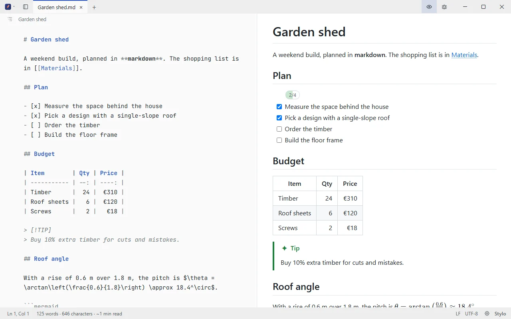

# Stylo

**Stylo** is a free, lightweight markdown editor for Windows. You write plain `.md` files with a live
preview next to them, or in a clean writing view that hides the markdown symbols. It has a Files
column for a folder of notes, links between notes, tags, math, diagrams, themes, and export to PDF
and HTML. No account, no cloud, no telemetry.

**Website:** <https://xarhssta.github.io/stylo-releases/>



## Download

Get the installer from the **[latest release](https://github.com/XarhsSta/stylo-releases/releases/latest)**:
`Stylo_X.Y.Z_x64-setup.exe`.

- Windows 10 or 11, 64-bit.
- It installs for your user only, without administrator rights.
- If WebView2 is missing (rare on Windows 10/11), the installer sets it up.

Once installed, Stylo checks this repository for new versions when it starts and offers to install
them. You can turn that off in Settings → General.

## "Windows protected your PC"

The installer is not code-signed: Stylo is a free, non-profit project, and a certificate costs money
every year. So on the first run, Windows SmartScreen shows *"Windows protected your PC"*. Click
**More info**, then **Run anyway**.

To make sure the file is the one published here, compare its SHA-256 with the `.sha256` file on the
same release page. In PowerShell, in the folder you downloaded both to:

```powershell
Get-FileHash .\Stylo_1.0.0_x64-setup.exe -Algorithm SHA256
Get-Content .\Stylo_1.0.0_x64-setup.exe.sha256
```

The two hashes must be the same (letter case does not matter). Or, in one line that prints `True`:

```powershell
(Get-FileHash .\Stylo_1.0.0_x64-setup.exe).Hash -eq (Get-Content .\Stylo_1.0.0_x64-setup.exe.sha256).Split(' ')[0]
```

## Privacy

Stylo collects nothing. The only request it makes on its own is the update check to GitHub, which
you can turn off. "Report a bug" opens a pre-filled GitHub issue in your browser, for you to read and
send yourself. Your documents stay where you save them; settings, unsaved drafts, version history and
a small local error log stay in `%LOCALAPPDATA%\gr.stylo.app`.

## Bugs and ideas

[Open an issue](https://github.com/XarhsSta/stylo-releases/issues/new/choose). The quickest way to
report a bug is **Report a bug** inside Stylo (the bug icon in the title bar), which fills in the version and Windows details for you.

## Licence

Stylo is **freeware**: free to download, use and share unmodified, but not open source, and not for
sale. See [LICENSE](LICENSE). It is built on open-source software, listed with its licences in
[THIRD-PARTY-NOTICES.md](THIRD-PARTY-NOTICES.md).

## About this repository

It holds Stylo's releases, its website (`docs/`) and its issues. The source code is private; its
release workflow publishes every version here, together with the `latest.json` that installed copies
read to update themselves (signed with Stylo's update key).
